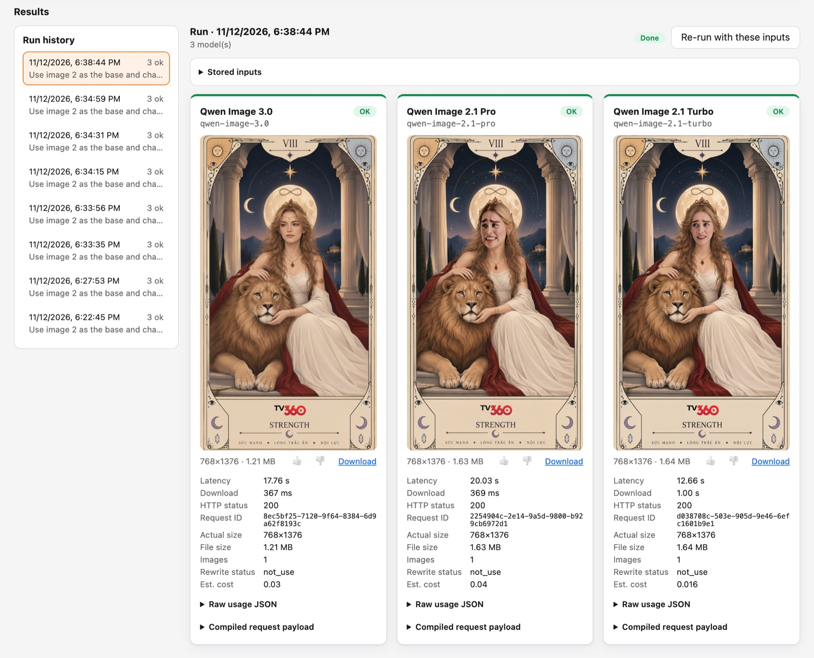
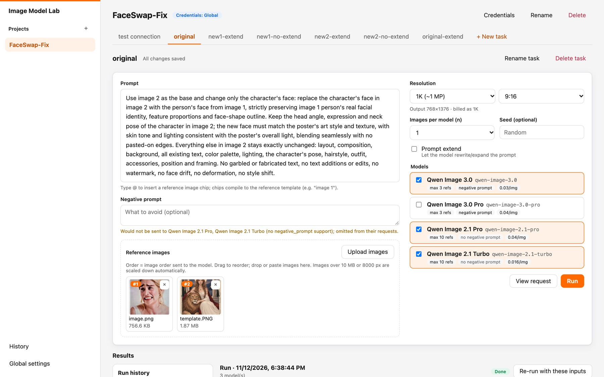
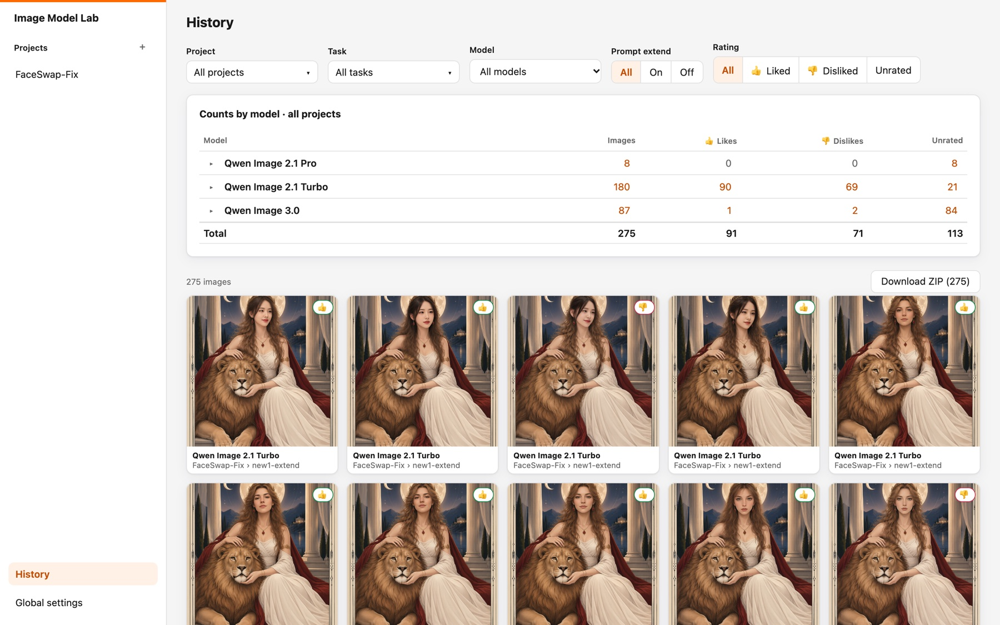

# Image Model Lab

**English** · [Tiếng Việt](README.vi.md)

A local studio for comparing image-generation models side by side. Write one prompt, pick several models, and see each model's images next to its latency, size, usage and estimated cost. Today it talks to the Qwen Image models on [Alibaba Cloud Model Studio](https://www.alibabacloud.com/help/en/model-studio/); more providers (OpenAI GPT Image and others) are on the [roadmap](#roadmap).

Everything runs on your machine: a Bun server bound to `127.0.0.1`, a SQLite file, and a vanilla-JS UI with no build step and no CDN. Your data lives in `./images/` and nothing is sent anywhere except to the model endpoint you configure.



## Features

- **Projects and tasks** to organise experiments; everything persists across restarts.
- **Credentials** (endpoint + API key) globally or overridden per project, with a no-cost connection test on save.
- **Side-by-side comparison**: one task runs the same inputs on one or more models in parallel. A failure on one model never affects the others.
- **Per-model stats**: latency, request id, actual size, file size, image count, seed, rewritten prompt, raw usage and estimated cost.
- **Ordered reference images** with `@` mentions in the prompt, an editable template (`image 1`, `image 2`, …) and a "View request" panel that shows the exact payload.
- **Editable model catalog**: API model id, price per image, reference-image limit, negative-prompt support.
- **History**: every image across projects, filterable by project, task, model, prompt-extend and rating; like/dislike (also with `l` / `k` in the viewer); arrow-key navigation; one-click ZIP of the filtered images.

Default catalog: Qwen Image 3.0, 3.0 Pro, 2.1 Pro and 2.1 Turbo. Edit it in the UI to add or rename models.

| Task editor: prompt, ordered reference images, model picker | History: counts by model, filters, ratings, ZIP export |
| --- | --- |
|  |  |

## Quick start

Requires [Bun](https://bun.sh) 1.3 or newer.

```bash
bun install
bun start
```

Open <http://127.0.0.1:4173>, click **Global settings**, and enter your Model Studio endpoint and API key. The endpoint can be a bare host such as `ws-<id>.ap-southeast-1.maas.aliyuncs.com` or a base URL ending in `/api/v1` or `/compatible-mode/v1`; the generation path is added for you.

No key yet? Try the UI against the bundled mock server:

```bash
bun run mock        # http://127.0.0.1:4199, API key: good-key
```

Then set the endpoint to `http://127.0.0.1:4199`.

## Configuration

| Variable     | Default    | Meaning                          |
| ------------ | ---------- | -------------------------------- |
| `PORT`       | `4173`     | Port on `127.0.0.1`              |
| `IMAGES_DIR` | `./images` | Where all data is stored         |
| `PUBLIC_DIR` | `./public` | Frontend files served to the UI  |

Data layout: `images/studio.db` (SQLite), `images/credentials.json` (mode `0600`), `images/projects/<project>/tasks/<task>/…` (reference and generated images).

## Development

```bash
bun test            # API tests run against an in-process mock of Model Studio
bun run typecheck
```

Backend code is in `src/server/`, the frontend in `public/`. See [CONTRIBUTING.md](CONTRIBUTING.md).

## Security notes

This is a single-user local tool, not a hosted service. It only listens on loopback, rejects foreign `Host` and `Origin` headers, and masks API keys in every response. Keys are stored in plain text in `images/credentials.json` (readable only by you), so do not commit or share the `images/` folder, and do not expose the port to a network. To report a vulnerability see [SECURITY.md](SECURITY.md).

## Roadmap

The next goal is to support more providers behind a single interface, so any task can compare models across vendors.

| Phase | Goal                                                                                          | Status  |
| ----- | --------------------------------------------------------------------------------------------- | ------- |
| 0     | Alibaba Cloud Model Studio (Qwen Image)                                                       | Done    |
| 1     | Provider abstraction: move Model Studio behind an `ImageProvider` interface, no behaviour change | Planned |
| 2     | Provider-aware UI: credentials per provider, parameters driven by each model's capabilities   | Planned |
| 3     | **OpenAI GPT Image** (generate and edit, base64 results, token-based cost)                    | Planned |
| 4     | More providers: Google Gemini image models, ByteDance Seedream, Black Forest Labs FLUX, Stability AI, any OpenAI-compatible endpoint | Ideas   |
| 5     | Async jobs, cancel a run, token-based cost for every provider, import/export                  | Ideas   |

Design details, the proposed interface and the file-by-file migration plan are in [docs/roadmap.md](docs/roadmap.md). Provider requests and contributions are welcome.

## License

[MIT](LICENSE)
